# DocLens

**Evidence-grounded document AI for Japanese, English and Bangla business documents.** PDFs, scans, images and PowerPoint become structured JSON in which every value points to the exact spot it was read from, and is checked against the document before anyone relies on it.

<!-- headline:start -->
On 24 synthetic Japanese invoices, Docling + qwen2.5-3b-instruct-q4_k_m (CPU, 4 cores) reached field F1 **0.88** on clean PDFs and **0.67** on scans. It predicted 67 wrong values out of 316: the evidence check flagged **45%** of them, and the evidence and arithmetic checks together flagged a problem in **62%** of the 24 documents that contained a wrong value.
<!-- headline:end -->

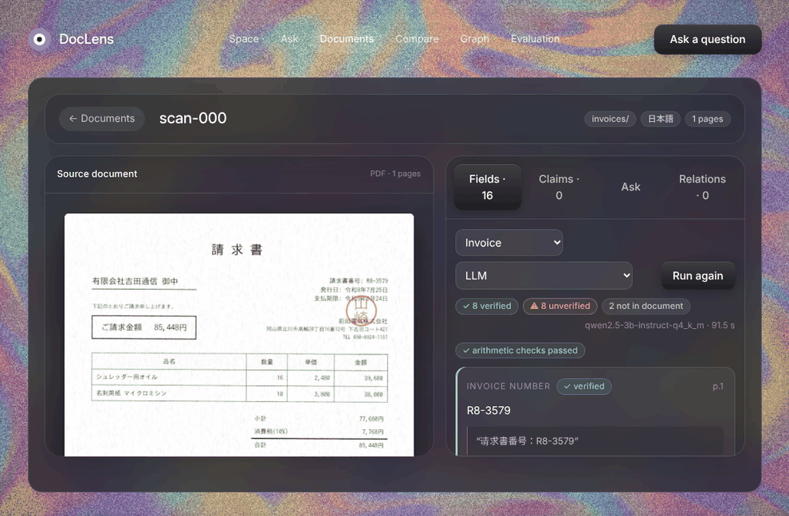

## Screenshots

Taken from the running app on the synthetic demo documents (`python -m backend.demo`). The extractions are real Qwen2.5-3B output, errors included: green is verified against the document, red is not, and clicking a field draws its box on the page.
The first three are Japanese, then English, then Bangla. The yen sign appears only on Japanese amounts; the "as printed" line under each value carries the real currency.

| | |
|---|---|
| 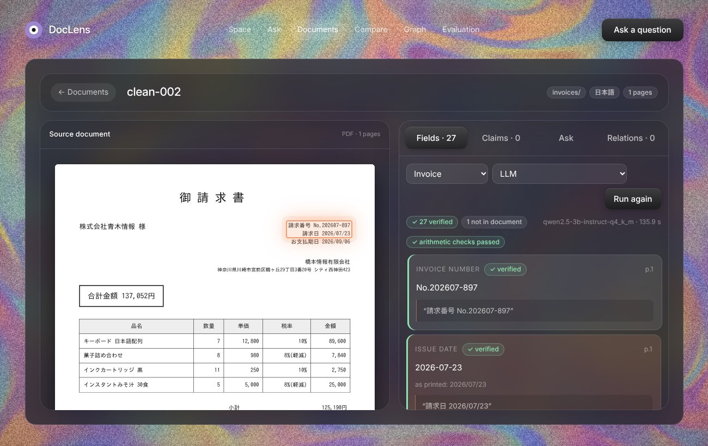 | 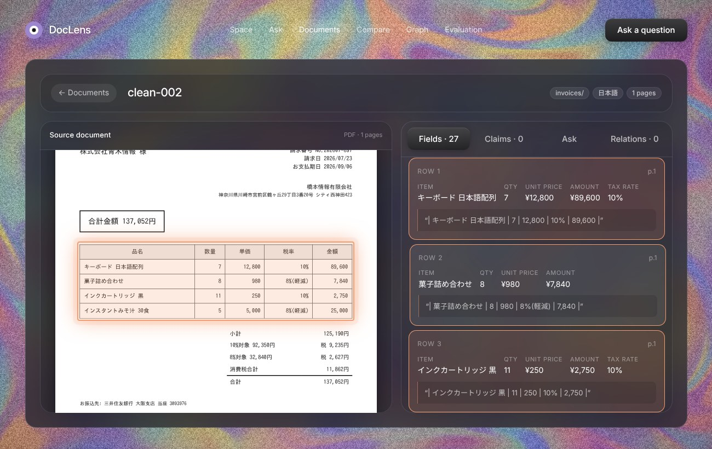 |
| **Japanese, clean PDF.** Verified fields in green, "arithmetic checks passed" above them, and the box on the page for the clicked value. | **Line items with 10% / 8% rates.** The whole items table is one element, so a click highlights all of it: boxes are element-level, not cell-level. |
| 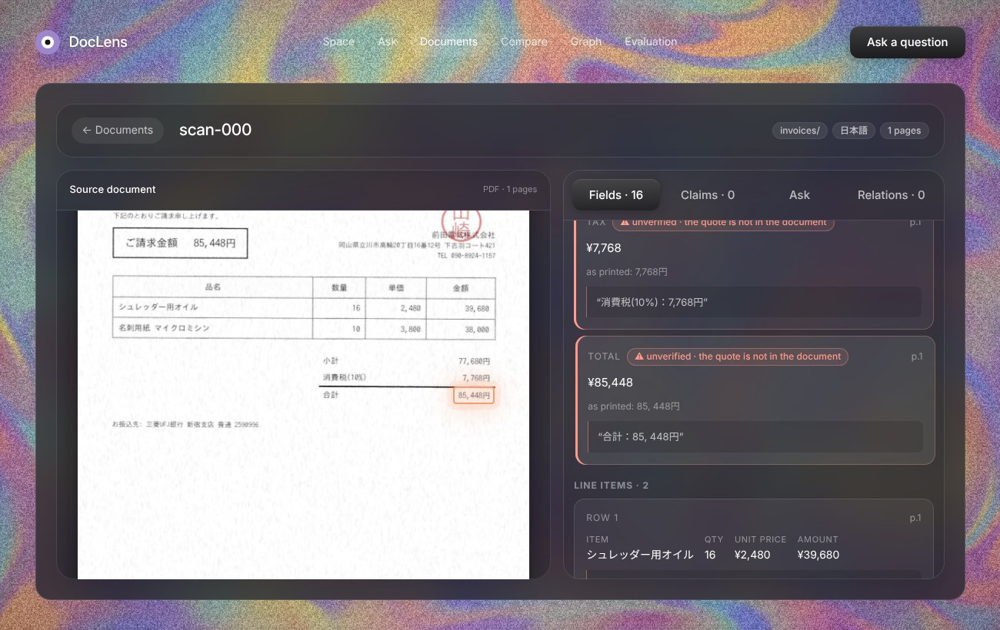 | 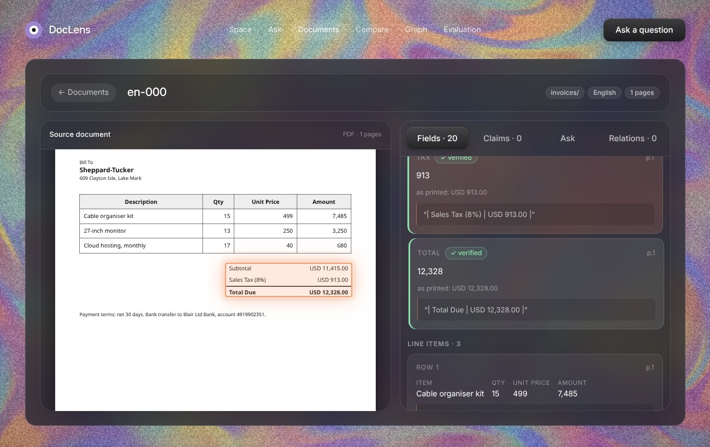 |
| **Japanese scan, a red field.** The model's quote (`合計：85, 448円`) is not in the OCR text, which printed the number with a stray space, so the value is flagged although it is right. | **English (USD).** Text-layer PDF, verified total. The tax-rate check says *skipped*: Japan's 10% / 8% are the only rates it knows. |
| 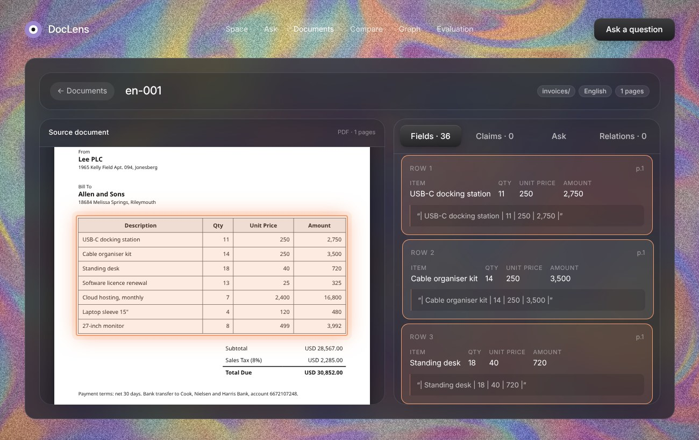 | 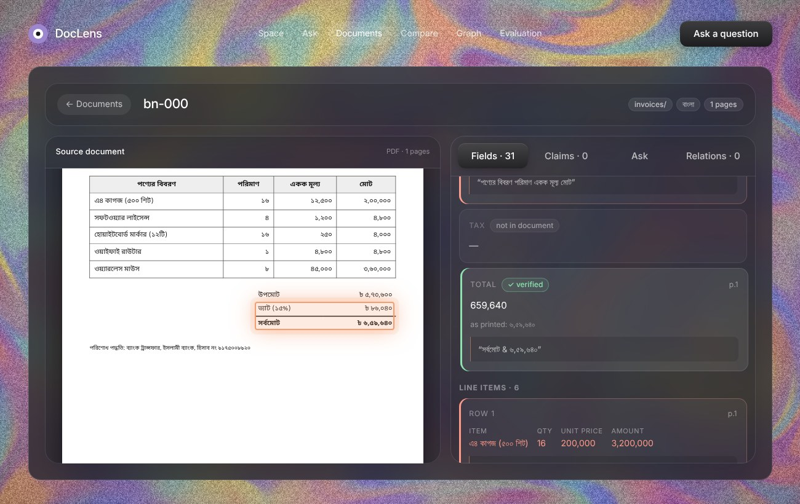 |
| **English line items.** Names, quantities and prices copied from the table, each row with its quote. | **Bangla (৳, Bangla digits, lakh grouping).** The page is OCR'd (a Bangla text layer is not trusted); `৬,৫৯,৬৪০` becomes `659640`. |
| 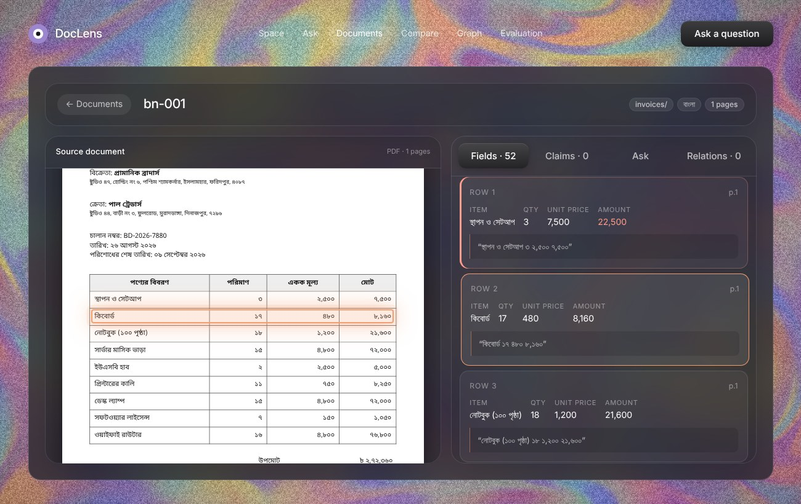 | 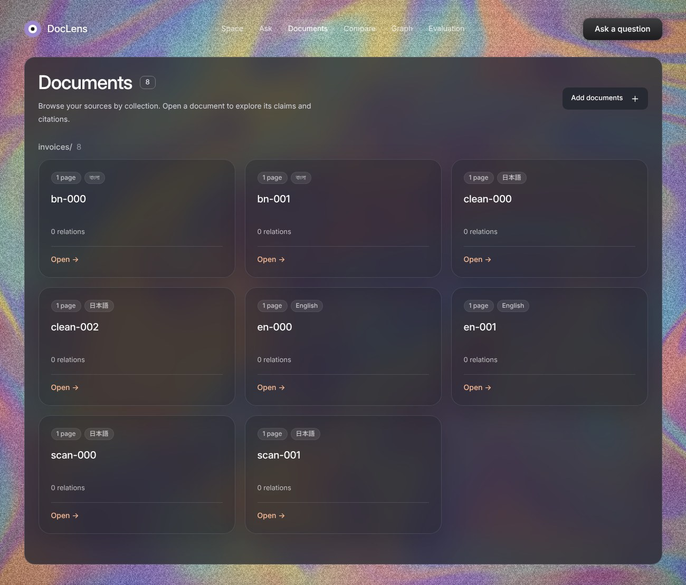 |
| **A Bangla error caught.** In row 1 the model took the printed amount (7,500) as the unit price and then wrote 3 × 7,500 = 22,500 as the amount. That number is not in the document, so it is red. | **Documents.** Japanese, English and Bangla in one space, each with a language badge. |

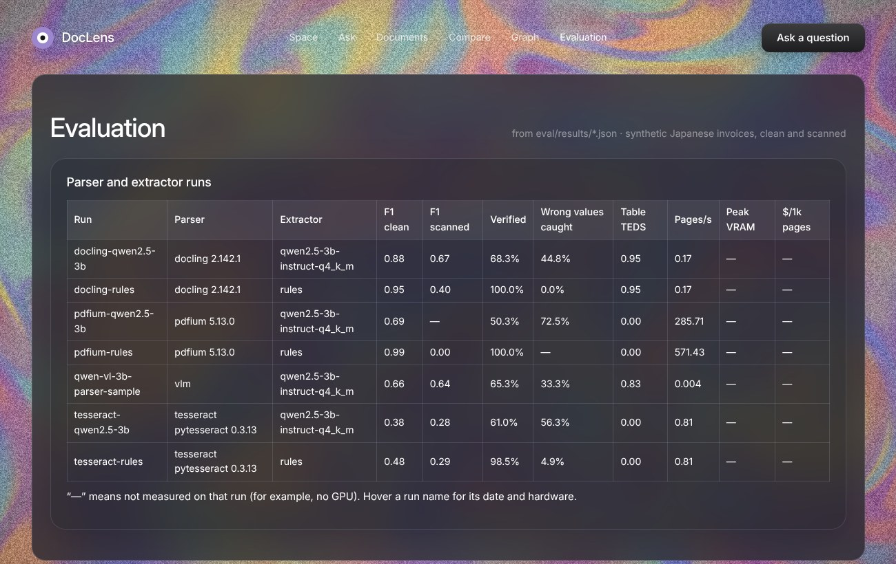

*The Evaluation page renders `eval/results/*.json`; nothing on it is typed in by hand.*

## Results

Every number below is produced by code: `eval/run_eval.py` writes `doclens/eval/results/*.json`, and `eval/render_tables.py` renders those files into this README.
Rows marked *not run* need a GPU; their notebooks are in [`doclens/notebooks/`](doclens/notebooks/). Definitions, setup and a failure-by-failure analysis are in [REPORT.md](REPORT.md).

<!-- results:start -->
**Parsers and extractors** on 24 synthetic Japanese invoices (clean text-layer PDFs and scanned image-only PDFs).

| Parser + extractor | Hardware | Field F1 (clean) | Field F1 (scanned) | Table TEDS | Parse pages/s | End-to-end s/doc | Peak VRAM | $/1k pages |
|---|---|---|---|---|---|---|---|---|
| Docling + qwen2.5-3b-instruct-q4_k_m | CPU, 4 cores | 0.88 | 0.67 | 0.95 | 0.17 | 150.1 | — | — |
| Docling + rules (regex) | CPU, 4 cores | 0.95 | 0.40 | 0.95 | 0.17 | 5.9 | — | — |
| PDF text layer (pdfium) + qwen2.5-3b-instruct-q4_k_m (clean only) | CPU, 4 cores | 0.69 | not in this run | 0.00 | 285.71 | 141.1 | — | — |
| PDF text layer (pdfium) + rules (regex) | CPU, 4 cores | 0.99 | 0.00 | 0.00 | 571.43 | 0.003 | — | — |
| VLM (qwen2.5-vl-3b-instruct-q4_k_m) + qwen2.5-3b-instruct-q4_k_m (sample: 6 docs) | CPU, 4 cores | 0.66 | 0.64 | 0.83 | 0.004 | 323.9 | — | — |
| Tesseract jpn+eng + qwen2.5-3b-instruct-q4_k_m | CPU, 4 cores | 0.38 | 0.28 | 0.00 | 0.81 | 74.2 | — | — |
| Tesseract jpn+eng + rules (regex) | CPU, 4 cores | 0.48 | 0.29 | 0.00 | 0.81 | 1.2 | — | — |
| PaddleOCR-VL + Qwen2.5-7B | GPU | not run | not run | not run | not run | not run | not run | not run |
| Qwen2.5-VL-7B zero-shot + Qwen2.5-7B | GPU | not run | not run | not run | not run | not run | not run | not run |
| Router (Docling, VLM on hard pages) + Qwen2.5-7B | GPU | not run | not run | not run | not run | not run | not run | not run |

On the 6 documents the sample run covers (clean-000, clean-001, clean-002, scan-000, scan-001, scan-002):

| Run | Field F1 (clean) | Field F1 (scanned) | Parse s/page | Extract s/doc |
|---|---|---|---|---|
| Docling + qwen2.5-3b-instruct-q4_k_m | 0.85 | 0.82 | 4.57 | 108.6 |
| Docling + rules (regex) | 0.94 | 0.34 | 4.57 | 0.0 |
| PDF text layer (pdfium) + qwen2.5-3b-instruct-q4_k_m (clean only) | 0.76 | — | 0.01 | 109.8 |
| PDF text layer (pdfium) + rules (regex) | 0.99 | 0.00 | 0.00 | 0.0 |
| VLM (qwen2.5-vl-3b-instruct-q4_k_m) + qwen2.5-3b-instruct-q4_k_m (sample: 6 docs) | 0.66 | 0.64 | 231.83 | 92.1 |
| Tesseract jpn+eng + qwen2.5-3b-instruct-q4_k_m | 0.46 | 0.31 | 1.30 | 67.6 |
| Tesseract jpn+eng + rules (regex) | 0.61 | 0.30 | 1.30 | 0.0 |

**Does the evidence check catch wrong values?**

| Run | Values predicted | Wrong | Wrong values flagged by the evidence check | Right values flagged anyway | Documents with a wrong value | …caught by evidence or arithmetic |
|---|---|---|---|---|---|---|
| Docling + qwen2.5-3b-instruct-q4_k_m | 316 | 67 | 45% | 28% | 24 | 62% |
| Docling + rules (regex) | 198 | 6 | 0% | 0% | 4 | 50% |
| PDF text layer (pdfium) + qwen2.5-3b-instruct-q4_k_m (clean only) | 165 | 51 | 73% | 39% | 12 | 92% |
| PDF text layer (pdfium) + rules (regex) | 161 | 0 | — | 0% | 0 | — |
| VLM (qwen2.5-vl-3b-instruct-q4_k_m) + qwen2.5-3b-instruct-q4_k_m (sample: 6 docs) | 49 | 12 | 33% | 35% | 4 | 75% |
| Tesseract jpn+eng + qwen2.5-3b-instruct-q4_k_m | 205 | 119 | 56% | 15% | 24 | 96% |
| Tesseract jpn+eng + rules (regex) | 131 | 41 | 5% | 0% | 21 | 43% |

**Router (F2)**

Cheap signals only (text layer, Docling table quality; no VLM involved): of 24 pages, **12/12 scanned pages** were sent to the VLM and **0/12 clean pages** were; 24/24 routed as the ground truth says. Reasons: scanned ×12, figure on the page ×12.

**English and Bangla** (6 synthetic invoices each; Bangla pages are read by OCR)

| Language | Parser | Extractor | Documents | Field F1 | Verified | Wrong values flagged | Documents failing an arithmetic check |
|---|---|---|---|---|---|---|---|
| Bangla | tesseract-ben | qwen2.5-3b-instruct-q4_k_m (before the Bangla prompt note: it translated into Japanese) | 6 | 0.43 | 44% | 81% | 6 |
| Bangla | tesseract-ben | qwen2.5-3b-instruct-q4_k_m | 6 | 0.56 | 66% | 60% | 6 |
| Bangla | tesseract-ben | rules (regex) | 6 | 0.77 | 100% | 0% | 3 |
| English | pdfium | qwen2.5-3b-instruct-q4_k_m | 6 | 0.85 | 63% | 62% | 4 |
| English | pdfium | rules (regex) | 6 | 1.00 | 100% | — | 0 |

**PowerPoint input (F5)**

2 synthetic decks (6 slides: bullets, a table and a chart each), read by Docling's PPTX backend: **100% of key facts** and **100% of table cells** recovered. Charts come out as figures without values.

**Chart → table (F6)**

| VLM | Charts | Valid JSON | Mean relative error (all) | …with printed data labels | …without | Points found |
|---|---|---|---|---|---|---|
| qwen2.5-vl-3b-instruct-q4_k_m | 6 | 100% | 4.0% | 8.1% | 1.2% | 67% |

**LoRA fine-tune, image → JSON (F8)**

_Not run yet: needs a GPU (`notebooks/kaggle_lora.ipynb`)._
<!-- results:end -->

## What makes it different

- **An evidence check on every value.** The model returns a value, the element it is in and a quote. The value is `verified` only if the quote is found in that element *and* the value is in the quote *and* in the element. (The last rule matters: fuzzy matching alone accepted a quote with one digit changed to fit a wrong value.) Verified fields are green in the UI, unverified ones red.
- **A router that spends the expensive model only where it is needed** (`PARSER=router`). Docling reads pages that have a text layer; pages that are scanned, contain a broken table or a figure, or whose fields fail verification go to a vision-language model. Its routing decisions are measured below; the accuracy-versus-GPU-seconds comparison needs a GPU and has not been run.
- **Dates and amounts handled in code, not by the LLM.** The model copies a value as printed; `normalize_ja.py` and `normalize_intl.py` turn `令和8年10月24日` into `2026-10-24`, `1億2,000万円` into `120000000`, `△1,234` into `-1234`, `24 October 2026` into `2026-10-24`, and `৳ ১২,৩৪,৫৬৭` (Bangla digits, lakh grouping) into `1234567`; 税込/税抜 is attached to the amount.
- **Arithmetic checks.** Line amounts, subtotal, subtotal + tax = total, tax at 10% or 8% per rate group, issue date ≤ due date. They catch wrong numbers that have a real quote behind them.

## Architecture

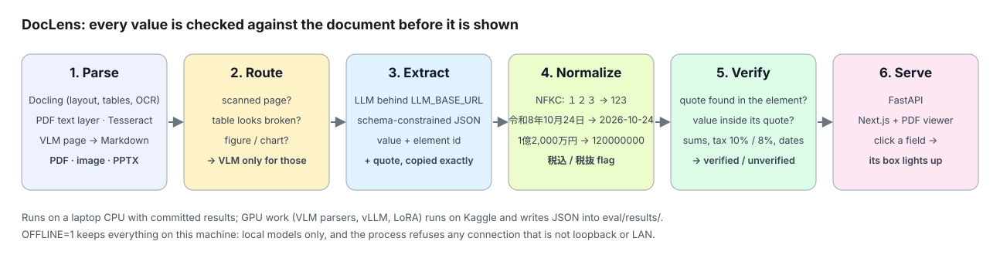

The app runs on a laptop CPU; GPU work (VLM parsers, vLLM, quantisation, LoRA) runs in Kaggle notebooks and writes JSON that is committed. `OFFLINE=1` keeps everything on the machine: local models only, and the process refuses any connection that is not loopback or on the LAN.

## Quickstart

```bash
cd doclens
pip install -r requirements.txt
python eval/run_eval.py --parser pdfium --extractor rules --out eval/results/pdfium-rules.json   # seconds; no model, no network
python -m backend.demo                       # four synthetic invoices, parsed and extracted into a demo space
uvicorn backend.app:app --port 8000 &        # the API
cd frontend && NEXT_PUBLIC_SPACE=demo npm install && NEXT_PUBLIC_SPACE=demo npm run dev
```

The eval command rewrites a committed result with your own timings (pass another `--out` to keep it). Open <http://localhost:3000/docs>, pick an invoice, click a field. For LLM extraction set `LLM_BASE_URL`, `LLM_API_KEY` and `LLM_MODEL` (any OpenAI-compatible server; see [`.env.example`](doclens/.env.example)); for Docling, scans, images and PPTX: `pip install -r requirements-extra.txt`; for Bangla pages also `apt install tesseract-ocr tesseract-ocr-ben` (Bangla PDFs are OCR'd, not read from their text layer). `pytest` runs the tests (about 240, no GPU or network). Developer guide: [doclens/README.md](doclens/README.md).

## Failure cases

Five failures from the runs above, with what went wrong, why (a hypothesis) and the fix I would try. The full analysis, with counts by cause, is in [REPORT.md](REPORT.md#4-failure-analysis).

**1. A verified field that is wrong.** The issuer is green and its quote is real, but the highlighted line is the addressee.
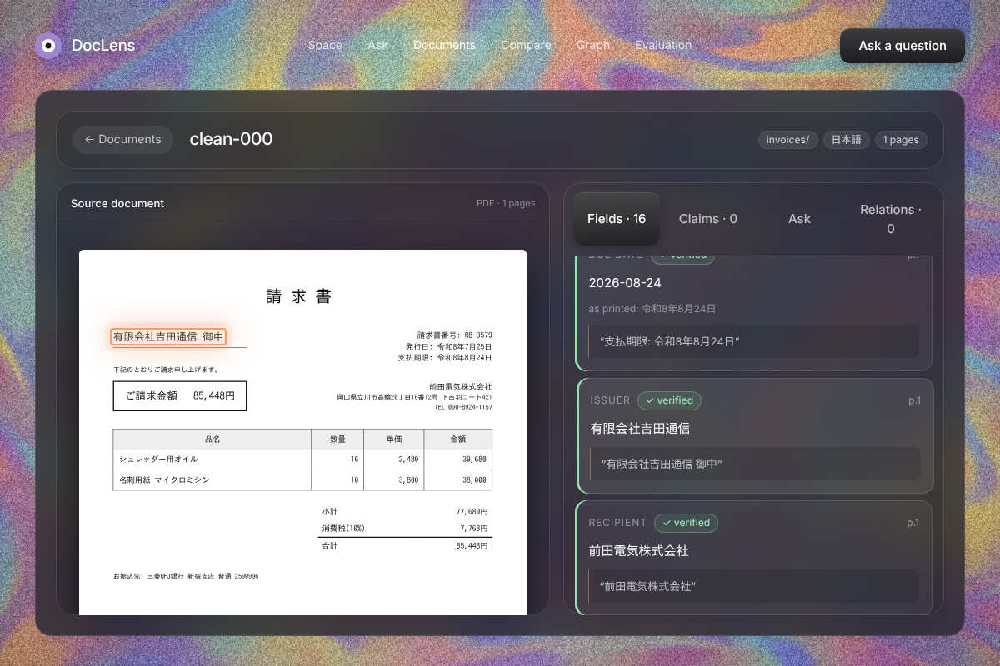
Qwen2.5-3B got every number and date right on clean pages (100%) and the issuer only 17% of the time. *Why:* "who sent it" is reading, not copying, and a 3B model leans on position. *Fix:* describe the roles by their evidence (address, TEL, bank vs 御中/様) and cross-check the quotes; or a bigger model.

**2. Item names that contain numbers break the columns.**
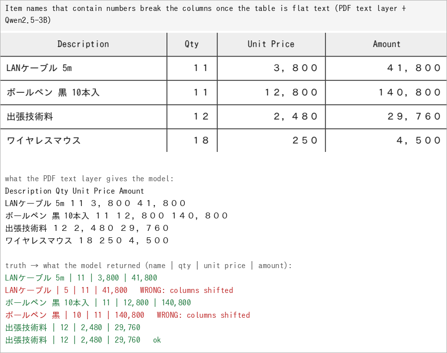
With the PDF text layer, line items were right for 25% of clean invoices; Docling's table structure gave 100%. The evidence check cannot see it (the cells are real); the arithmetic checks flagged 8 of 12 documents. *Fix:* keep table structure, keep the arithmetic checks.

**3. A seal over a header, and OCR confusions on scans.**
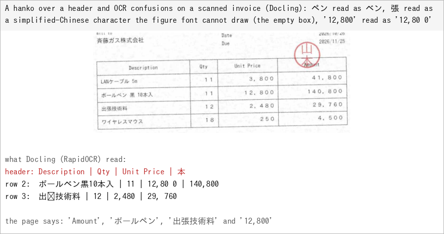
On scans, Docling + rules fell from 0.95 to 0.40 field F1. *Why:* the default OCR models, plus a red 印 on top of text. *Fix:* remove the seal channel before OCR, or send scanned pages to a VLM (the router).

**4. A correct value flagged, a wrong one passed.**
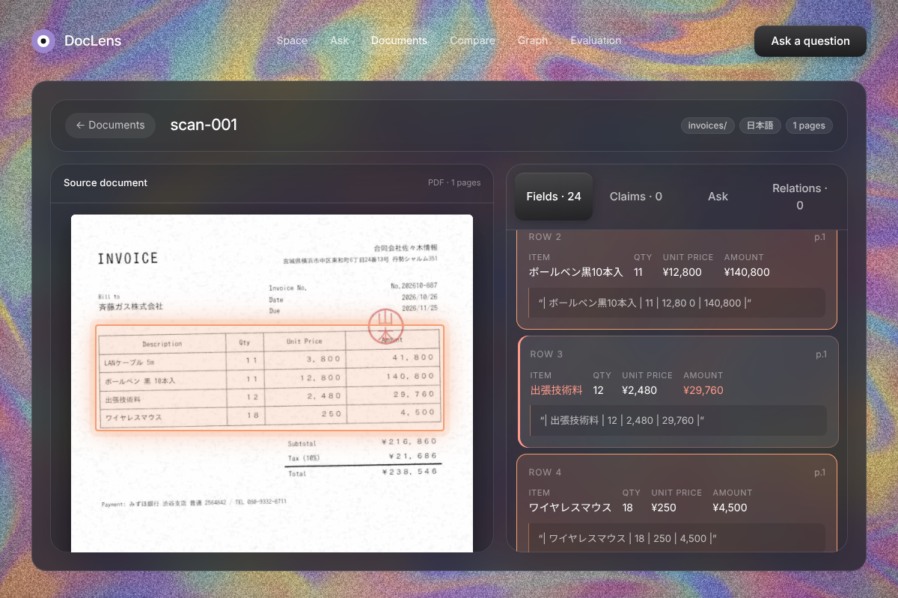
The check measures faithfulness to the parsed text, not truth. The model "fixed" the OCR's `出张技術料` to `出張技術料` (right, flagged); the row above kept the OCR's `ボールベン` (wrong, verified). Sloppy multi-row quotes add false alarms: 28% of right values were flagged. *Fix:* verify cell by cell, cell-level boxes.

**5. Labels and values in different elements.**
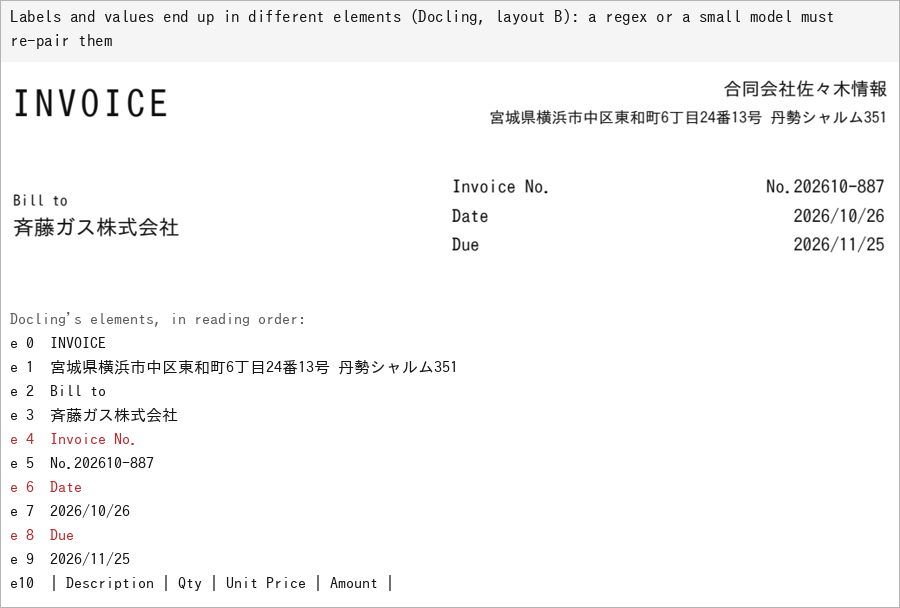
The regex baseline loses these fields on clean pages; the LLM copes. *Fix:* pair by geometry, or let a VLM see the page. A zero-shot 3B VLM parser, for its part, returned only the table on every scan and took 232 s per page ([REPORT §4.8](REPORT.md#4-failure-analysis)).

## Design trade-offs

- **The LLM copies, code normalises.** Era dates, 万/億 amounts and full-width digits are deterministic, testable and free; asking a model to convert them adds a second way to be wrong. The raw string is kept, so the evidence check runs on what is printed.
- **One element, one chunk, one box.** Elements keep their page and box, so a citation maps to exactly one highlight. The cost: a value in a table highlights the whole table, not its cell, and merged cells are flattened.
- **numpy and BM25 instead of a vector database.** A few thousand chunks fit in memory, the index is rebuilt in seconds, and there is nothing to deploy. Past roughly 100k chunks this should move to a real index.
- **A small, constrained model on purpose.** A 3B model on CPU is slow and makes mistakes a 7B would not; that is what makes the evidence check measurable, and it is what an on-premise customer without a GPU would run. The same code points at a hosted or larger model with one environment variable.
- **Quote first, verify always.** Asking for quotes costs tokens (a 3B model's quotes dominated its runtime until the schema bounded them), but it is the only thing that lets a reader check a value in one click.

## Limitations

- **Small and synthetic.** 24 documents (12 invoices, each as a clean PDF and as a scan) with exact ground truth, three layouts, one page each. Real documents differ in ways the generator does not model; scores here say nothing about them. A real-document slice (hand-labelled, redistributable PDFs) is the most important missing piece.
- **The rules baseline was written after looking at the three layouts**, so its clean-slice score is an upper bound for rules.
- **Evidence is not correctness.** The check catches values that are not in the document; it cannot catch a real value put in the wrong field (issuer and recipient swapped is the common case in the LLM runs below).
- **No GPU in this work.** The VLM parsers, vLLM serving, the quantisation comparison, the chart experiment and the LoRA fine-tune are implemented and unit-tested where possible, and are listed as *not run*. The LoRA training script has not been executed at all.
- **Not OmniDocBench-style.** Metrics are field-level and table-level on invoices, not page-level reading-order or formula scores.
- **PowerPoint and image input** go through Docling only; chart values inside slides are not read.
- **Bangla is the thinnest language here.** Six synthetic, clean, single-column invoices. A Bangla PDF's text layer is not trusted (spaces inside words, overlapping boxes), so those pages are OCR'd with Tesseract; legacy-font Bangla PDFs, scans and handwriting were not tested. The 3B model reads OCR'd Bangla worse than a regex does (F1 0.56 against 0.77), and without a one-line prompt note it translated Bangla into Japanese ([REPORT §4.11](REPORT.md#4-failure-analysis)).

## Roadmap

Run the GPU notebooks and fill the *not run* rows · a real-document slice with hand labels · chart → table on a VLM (`eval/run_charts.py`) · vLLM FP16 vs 4-bit comparison (`notebooks/kaggle_arena.ipynb`) · LoRA fine-tune for image → JSON (`notebooks/kaggle_lora.ipynb`) · cell-level boxes for table values.

## License

MIT, see [LICENSE](LICENSE).
